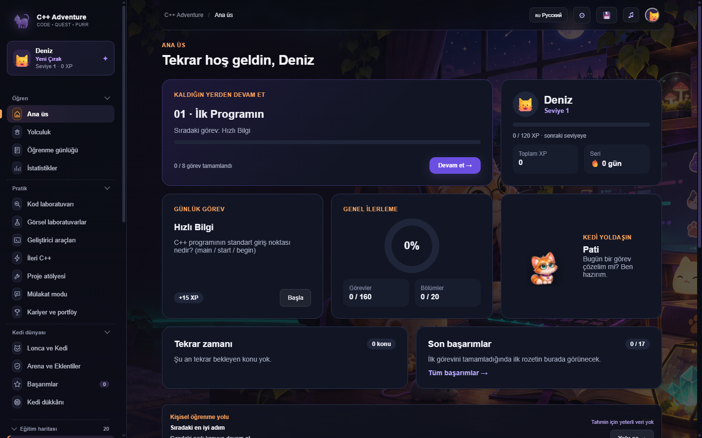

# C++ Adventure

C++ öğrenmek için kedili bir macera oyunu. Dersler, görevler ve geri bildirimler Türkçe ve Rusçadır. Yazdığın kod bilgisayarındaki gerçek G++ derleyicisiyle derlenip güvenli bir sandbox içinde çalıştırılır. Uygulama internet olmadan çalışır; isteğe bağlı AI öğretmen ise ücretsiz bir çevrimiçi servis kullanır.



**Sürüm:** 0.5.0 · **Platform:** Windows 10/11 (64 bit) · **Diller:** Türkçe, Русский

---

## İçindekiler

- [Özellikler](#özellikler)
- [Sistem gereksinimleri](#sistem-gereksinimleri)
- [Kurulum](#kurulum)
- [İlk kullanım](#ilk-kullanım)
- [Ayarlar](#ayarlar)
- [Ücretsiz AI öğretmen (isteğe bağlı)](#ücretsiz-ai-öğretmen-isteğe-bağlı)
- [Verilerin, yedekler ve geri yükleme](#verilerin-yedekler-ve-geri-yükleme)
- [Kaldırma](#kaldırma)
- [Kaynak koddan paket oluşturma](#kaynak-koddan-paket-oluşturma)
- [Testler ve puanlar](#testler-ve-puanlar)
- [Güvenlik ve gizlilik](#güvenlik-ve-gizlilik)
- [Sorun giderme](#sorun-giderme)
- [Ortam değişkenleri](#ortam-değişkenleri)
- [Proje yapısı](#proje-yapısı)
- [Belgeler](#belgeler)

---

## Özellikler

- **24 bölüm, 192 görev:** İlk programdan başlayıp pointer, akıllı işaretçiler, kalıtım, şablonlar ve STL'e uzanır. Modern C++ bölümleri de var: taşıma semantiği, `optional`/`variant`/`string_view`, concepts ve ranges, gerçek `std::thread`/`mutex`/`atomic`.
- **Her bölümde aynı yapı:**
  - Önce konu anlatımı gelir: kod örnekleri, sık yapılan hatalar ve satır satır oynayan "canlı anlatım" animasyonları.
  - Ardından 8 görev çözülür: kavram sorusu, çıktı tahmini, hata düzeltme, ısınma, pratik ve bölüm sonu boss'u.
- **Gerçek değerlendirme:** Kod gerçekten derlenir ve gizli testlerle çalıştırılır. Görevin istediği C++ yapısının gerçekten kullanıldığı da denetlenir. Programın yazdırması gereken çıktılar İngilizcedir; görev açıklamaları Türkçe ve Rusçadır.
- **Yetenek ağacı:** Bölümler ön koşullara göre açılır. Kilitli bir bölüme tıklayınca hangi bölümlerin bitirilmesi gerektiği gösterilir.
- **Kod editörü:** Monaco editörü, C++ önerileri, program girdisi ve çıktısı paneli. Monaco yüklenemezse sade bir yedek editör devreye girer.
- **Oyun öğeleri:**
  - XP, seviye ve günlük seri
  - Başarımlar
  - Kedi yoldaş ve aksesuar dükkânı
  - Lonca ve dünya haritası
  - Günlük Arena
- **Pratik alanları:**
  - Kod laboratuvarı
  - Görsel laboratuvarlar (bellek, pointer, sıralama, çağrı yığını)
  - Geliştirici araçları (Git, CMake ve terminal simülasyonu)
  - Çok dosyalı proje atölyesi
  - Mülakat modu ve kariyer/portföy
- **Öğrenme günlüğü ve istatistikler:** Hangi konularda güçlü olduğunu, nerede tekrar gerektiğini ve çalışma süreni gösterir.
- **Erişilebilirlik:**
  - Tüm uygulama klavyeyle kullanılabilir.
  - Görünüm değişince odak sayfa başlığına gider.
  - Yazı boyutu ayarlanabilir: %100–150, Ctrl + Artı / Eksi ile de.
  - "Animasyonları azalt" seçeneği var.
- **Profiller:** Aynı bilgisayarda birden çok oyuncu olabilir; her profil isteğe bağlı PIN ile kilitlenebilir.

## Sistem gereksinimleri

| Bileşen | Gerekli mi? | Not |
|---|---|---|
| Windows 10 veya 11, 64 bit | Evet | |
| Microsoft Edge WebView2 Runtime | Evet | Windows 11'de hazır gelir. Eksikse uygulama ücretsiz indirme bağlantısını gösterir. |
| G++ derleyicisi (MSYS2 UCRT64 önerilir) | Kod görevleri için evet | Dersler, quizler ve tahmin soruları derleyicisiz de çalışır. |
| İnternet | Hayır | Yalnızca isteğe bağlı AI öğretmen ve ilk kurulumdaki indirmeler için gerekir. |
| Python 3.10+ | Yalnızca kaynak koddan çalıştırmak için | Kurulu uygulama Python istemez. |

## Kurulum

### 1. C++ derleyicisini kur (bir kez)

1. https://www.msys2.org adresinden MSYS2'yi indirip kur. Varsayılan konum `C:\msys64` uygundur. Alternatif: `winget install MSYS2.MSYS2`.
2. Başlat menüsünden **MSYS2 UCRT64** penceresini aç ve şunu çalıştır:

   ```bash
   pacman -S --needed mingw-w64-ucrt-x86_64-gcc
   ```

3. Bu kadar. Uygulama derleyiciyi önce `PATH` içinde arar. Orada bulamazsa `C:\msys64\ucrt64\bin` gibi standart MSYS2 konumlarına bakar; yani PATH ayarı yapmak zorunda değilsin. Başka bir konum kullanıyorsan `CPP_ADVENTURE_COMPILER` ortam değişkenine `g++.exe` dosyasının tam yolunu yaz.

### 2a. Kurulum dosyasıyla (önerilen)

1. Kurulum dosyasını çalıştır. Hazır bir kurulum dosyası dağıtılmıyor; önce [kaynak koddan üretmen](#kaynak-koddan-paket-oluşturma) gerekir. `build-windows.bat` çalıştırıldığında dosya `dist\` klasörüne şu adla çıkar:
   - Inno Setup 6 kuruluysa `C++Adventure-Setup-0.5.0.exe` (kaldırıcısı olan kurulum, önerilen).
   - Inno Setup yoksa `C++Adventure-Setup.exe` (tek dosyalık eski kurulum, kaldırıcısı yok).

   Kurulum yönetici izni istemez ve programı yalnızca senin Windows hesabına kurar.
2. Kurulum dilini seç (Türkçe veya Русский) ve adımları izle. Masaüstü kısayolu isteğe bağlıdır.
3. Uygulama açıksa kurulum, devam etmeden önce kapatmanı ister. WebView2 eksikse bunu bildirir.

Kurulum dosyası imzalı değildir; Windows SmartScreen "Bilinmeyen yayımcı" uyarısı gösterebilir. Bu durumda **Ek bilgi → Yine de çalıştır** seç. Kurulum dosyasını kendin üretmek için [Kaynak koddan paket oluşturma](#kaynak-koddan-paket-oluşturma) bölümüne bak.

### 2b. Kaynak koddan çalıştırma (geliştiriciler için)

```bat
:: Proje klasöründe
setup-desktop.bat      :: .venv oluşturur ve sabitlenmiş bağımlılıkları kurar (internet gerekir)
start-desktop.bat      :: masaüstü penceresinde açar
```

- `start-desktop.bat`, `dist\CppAdventure\CppAdventure.exe` varsa onu açar; yoksa kaynak kodu `.venv` içindeki Python ile çalıştırır.
- Tarayıcıda açmak için: `start-browser.bat`. Bu, `python server.py` komutunu çalıştırır ve http://127.0.0.1:8765 adresini açar.
- Bağımlılıkların tam sürümleri `requirements-desktop.lock.txt` dosyasındadır.

## İlk kullanım

1. **Karakterini seç:** 7 kedi karakteri var. Bir isim gir; istersen 4–8 haneli bir PIN de belirle.
2. **Ana üs:** "Kaldığın yerden devam et" kartı seni sıradaki göreve götürür.
3. **Ders:** Önce konu anlatımını oku. Canlı anlatımlar ekrana girince kendiliğinden oynar.
4. **Görevler:** Sırayla açılır; çözdüğün görev sıradakini açar. Kod görevlerinde:
   - kodu yaz,
   - **Çalıştır** ile dene,
   - **Görevi gönder** ile değerlendirt.
5. **İpucu:** Takılırsan ipuçlarını kullanabilirsin. Kullanılan ipucu, o görevden kazanılan XP'yi %10 azaltır.
6. **Bölüm sonu:** Bölümün boss'unu yenince yetenek ağacında ona bağlı bölümler açılır.

Kısayollar:

| Kısayol | Ne yapar |
|---|---|
| Ctrl + S | Kaydetme ve yedekleme penceresi |
| Ctrl + Artı / Eksi / 0 | Yazı boyutunu büyüt / küçült / sıfırla |
| Ctrl + M (editörde) | Tab tuşunun girinti eklemesi ile odağı taşıması arasında geçiş |
| Tab ilk basış | "İçeriğe geç" bağlantısı |

## Ayarlar

⚙ düğmesiyle açılır:

- **AI öğretmen:** Ücretsiz çevrimiçi AI (Groq), çevrimdışı ipuçları ya da kapalı.
- **Görünüm:** Yazı boyutu (%100 / 115 / 130 / 150) ve **Animasyonları azalt**.
- **Dil:** Üst çubuktaki Русский / Türkçe düğmesi; anında değişir.

## Ücretsiz AI öğretmen (isteğe bağlı)

AI öğretmen yalnızca **Groq'un ücretsiz planını** kullanır. Kredi kartı gerekmez, ücret alınmaz ve bilgisayarına model indirilmez.

1. https://console.groq.com/keys adresinde ücretsiz bir hesap aç ve bir API anahtarı oluştur. Anahtar `gsk_` ile başlar.
2. Uygulamada ⚙ Ayarlar → **Groq API anahtarı** kutusuna yapıştır ve **Anahtarı kaydet**'e bas. Anahtar, token harcamadan sınanır.
3. Bir kod görevinde **Kodumu incele**'ye bas. Kodun her seferinde, ancak sen onay verdikten sonra gönderilir.

Ayrıntılar:

- **Üç seviyeli ipucu:** İlki yön gösterir, ikincisi hatalı satırı işaret eder, üçüncüsü adım adım anlatır. Tam çözüm hiçbir seviyede yazılmaz.
- **Gönderilmeyenler:** Adın, profil kimliğin ve gizli testler Groq'a gitmez.
- **Çevrimdışı ipucu:** İnternet yoksa, sınır dolduysa ya da anahtar yoksa çevrimdışı ipucu gösterilir ve nedeni açıklanır.
- **Anahtarın saklanması:** Anahtar `%LOCALAPPDATA%\CppAdventure\secrets` içinde, Windows DPAPI ile şifreli saklanır. Kayıt dosyalarına ve sayfaya gönderilmez.

## Verilerin, yedekler ve geri yükleme

| Ne | Kurulu uygulamada | Kaynak koddan çalışırken |
|---|---|---|
| Veritabanı (profiller, ilerleme) | `%LOCALAPPDATA%\CppAdventure\data\adventure.db` | `data\adventure.db` |
| Otomatik yedekler | `%LOCALAPPDATA%\CppAdventure\backups\` | `backups\` |
| Günlükler (açılış, beklenmeyen hatalar) | `%LOCALAPPDATA%\CppAdventure\logs\` | `logs\` |
| VS Code ile açılan kod | `%LOCALAPPDATA%\CppAdventure\student-work\` | `student-work\` |

Yedekleme:

- **Otomatik yedekler:** Uygulama, veritabanı şemasını yükseltmeden ve bir yedekten geri yüklemeden önce doğrulanmış bir kopya alır. Kopyalar `backups\` klasörüne yazılır ve uygulama onları **hiçbir zaman silmez**.
- **Elle yedekleme:** Ctrl + S ile açılan pencerede üç seçenek var:
  - **Dışa aktar:** Seçili profili bir JSON dosyasına kaydeder. PIN bu dosyaya yazılmaz.
  - **İçe aktar:** Bir JSON dosyasını seçili profile geri yükler. PIN'li profillerde PIN sorulur.
  - **Yedek al:** Tüm veritabanının bir kopyasını alır.

Bir yedeği elle geri yüklemek için:

1. Uygulamayı kapat.
2. `adventure.db` dosyasını başka bir yere taşı.
3. `backups\` içindeki istediğin dosyayı `adventure.db` adıyla `data\` klasörüne kopyala.
4. Uygulamayı yeniden aç.

## Kaldırma

**Ayarlar → Uygulamalar → C++ Adventure → Kaldır**. Ya da Denetim Masası → Programlar.

- Program dosyaları ve öğrenci kodu sandbox profili (yalnızca geçici çalıştırma dosyaları) silinir.
- **Profillerin, ilerlemen ve yedeklerin silinmez.** Bunlar `%LOCALAPPDATA%\CppAdventure` klasöründe kalır; tamamen kaldırmak istersen o klasörü kendin silebilirsin.

## Kaynak koddan paket oluşturma

```bat
build-windows.bat
```

1. `.venv` hazırlanır ve PyInstaller ile `dist\CppAdventure\CppAdventure.exe` oluşturulur. Exe, sürüm bilgisini taşır ve UPX ile sıkıştırılmaz.
2. **Inno Setup 6** kuruluysa (ücretsiz: https://jrsoftware.org/isdl.php) `dist\C++Adventure-Setup-<sürüm>.exe` kurulum dosyası üretilir. Bu kurulumun kaldırıcısı vardır, Türkçe/Rusça kurulum ekranı sunar ve açık uygulamayı kapattırır. Betik: `installer\CppAdventure.iss`.
3. Inno Setup yoksa eski tek dosyalık kurulum (`dist\C++Adventure-Setup.exe`) üretilir. Bunun kaldırıcısı yoktur.

Sürüm numarası tek yerde tutulur: `server.py` → `APP_VERSION`.

## Testler ve puanlar

```bat
.venv\Scripts\python.exe -B -m unittest discover -s tests
:: MSYS2 Python ile oluşturulan ortamda: .venv\bin\python.exe
```

Test paketinde 302 test var. Tam çalıştırma yaklaşık 5 dakika sürer, çünkü görev çözümleri gerçek G++ ile derlenir. Test ayrıntıları, aşamalara göre sonuçlar ve görsel/teknik kalite puanları **[SCORES.md](SCORES.md)** dosyasındadır.

## Güvenlik ve gizlilik

- **Öğrenci kodu sandbox'ı:** Kod, Windows'ta yetkisiz bir AppContainer ve Job Object içinde çalışır:
  - ağ yok, kullanıcı dosyalarına erişim yok, alt süreç başlatılamaz;
  - bellek ve süre sınırı var, çıktı 64 KB ile sınırlı.
  - Derleme zamanında dosya okumaya yarayan hileler engellenir: dış yollu `#include`, `#embed`, `.incbin`.
- **Yerel API:**
  - Yalnızca `127.0.0.1` adresinden erişilebilir.
  - Her açılışta yenilenen bir oturum çerezi ister.
  - Katı CSP ve güvenlik başlıkları kullanır.
  - PIN'li profiller, PIN girilmeden açılmaz.
- **Cevapların saklanması:** Görevlerin cevapları ve gizli testleri tarayıcıya gönderilmez. Başarısız bir gizli testin girdisi ve beklenen çıktısı da gösterilmez.
- **Varsayılan durum:** Uygulama çevrimdışıdır. AI öğretmen yalnızca anahtar eklendiğinde ve her istekte onay verildiğinde veri gönderir.

## Sorun giderme

| Belirti | Çözüm |
|---|---|
| "G++/Clang++ bulunamadı" | [Derleyiciyi kur](#1-c-derleyicisini-kur-bir-kez). Standart dışı bir konumdaysa `CPP_ADVENTURE_COMPILER` ortam değişkenini ayarla. |
| Uygulama açılmıyor, WebView2 uyarısı çıkıyor | Gösterilen bağlantıdan WebView2 Runtime'ı kur (ücretsiz): https://go.microsoft.com/fwlink/p/?LinkId=2124703 |
| İkinci kez açınca yeni pencere gelmiyor | Normal: uygulama tek kopya çalışır ve açık pencereyi öne getirir. |
| "Beklenmeyen bir hata oluştu (kod …)" | Ayrıntı `logs\server-errors.log` dosyasındadır; hata koduyla aranabilir. |
| Açılışta hata mesajı | `%LOCALAPPDATA%\CppAdventure\logs\startup.log` dosyasına bak. |
| AI öğretmen yanıt vermiyor | Ayarlar → **Anahtarı sına**. Ücretsiz sınır dolduysa bir süre bekle; bu sırada çevrimdışı ipuçları çalışır. |
| Yazılar küçük | Ayarlar → Görünüm → Yazı boyutu, ya da Ctrl + Artı. |

## Ortam değişkenleri

| Değişken | Ne işe yarar |
|---|---|
| `CPP_ADVENTURE_COMPILER` | `g++.exe` veya `clang++.exe` dosyasının tam yolu |
| `GROQ_API_KEY` | Groq anahtarı (Ayarlar'a girmek yerine) |
| `CPP_ADVENTURE_GROQ_MODEL`, `CPP_ADVENTURE_GROQ_FALLBACK_MODEL` | Kullanılacak Groq modelleri |
| `CPP_ADVENTURE_ADMIN=1` | Geliştirme için test panelini açar (Ctrl + Shift + A). Dağıtılan sürümde kapalıdır. |
| `CPP_ADVENTURE_SANDBOX=job` | AppContainer yerine yalnızca Job Object kullanır (yalnızca hata ayıklama için) |

## Proje yapısı

```
server.py            Yerel HTTP sunucusu, API uç noktaları, değerlendirme
desktop.py           Masaüstü penceresi (WebView2), tek kopya, WebView2 denetimi
curriculum.py        Müfredat (bölüm 1–20) + modern_cpp.py (bölüm 21–24)
mission_contracts.py Kod, hata düzeltme ve boss görevlerinin testleri
concept_checker.py   "İstenen C++ yapısı kullanıldı mı?" denetimi
sandbox*.py          Öğrenci kodunun güvenli derlenmesi ve çalıştırılması
db_migrations.py     Sürümlü veritabanı yükseltmeleri ve yedekler
ai_tutor.py          Ücretsiz Groq AI öğretmeni
error_catalog.py     Hata kodları ve Rusça hata mesajları
web/                 Arayüz (HTML/CSS/JS), locales.json (TR/RU metinler), Monaco editörü
tests/               302 otomatik test
installer/           Inno Setup betiği ve eski kurulum yardımcıları
docs/                Raporlar ve ekran görüntüleri
```

## Belgeler

| Belge | İçerik |
|---|---|
| [SCORES.md](SCORES.md) | Test sonuçları ve kalite puanları |
| [docs/UX_AUDIT.md](docs/UX_AUDIT.md) | Görsel UI/UX, erişilebilirlik ve teknik denetim; önce/sonra ekran görüntüleri |
| [docs/FINAL_REPORT.md](docs/FINAL_REPORT.md) | Modernizasyon (Faz 0–12) sonuç raporu |
| [DEVELOPMENT_LOG.md](DEVELOPMENT_LOG.md) | Aşama aşama geliştirme kaydı |
| [DEVAM.md](DEVAM.md) | Eski Türkçe ilerleme notları |

## Görseller

Kedi karakterleri, maskot ve arka plan çizimleri bu proje için üretilmiştir ve `web/assets/` klasöründedir. Uygulama hiçbir görseli internetten yüklemez. Monaco editörü kendi lisansıyla `web/vendor/` altında gelir. Projenin kendisi için henüz bir lisans dosyası yoktur.
