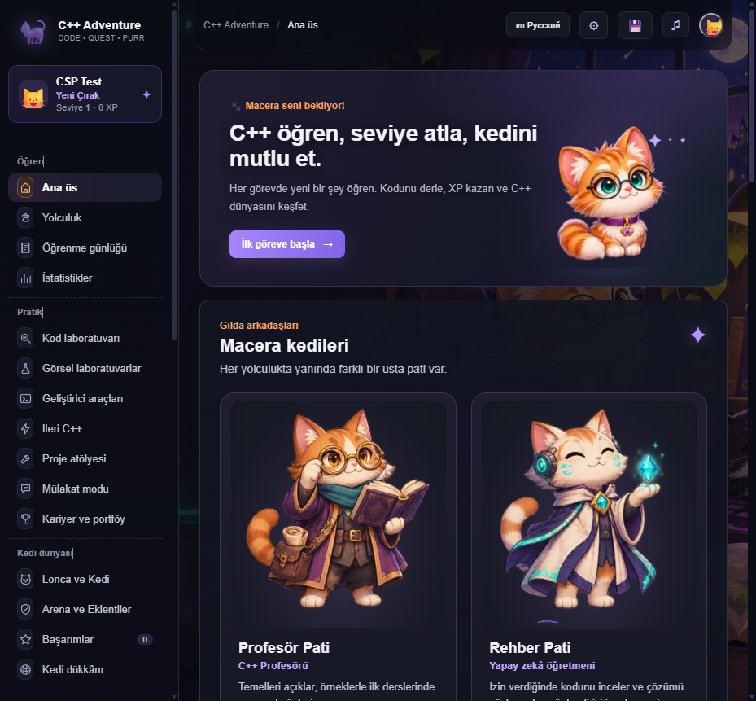
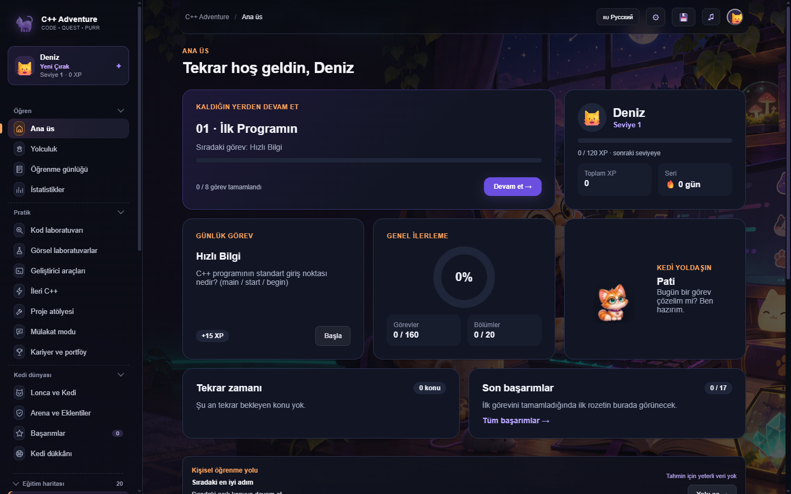
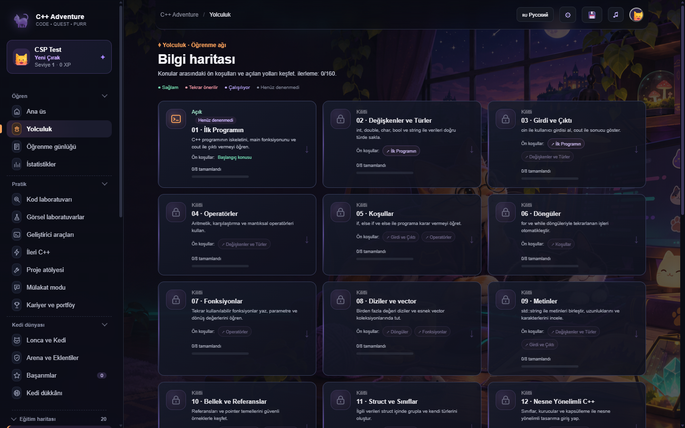
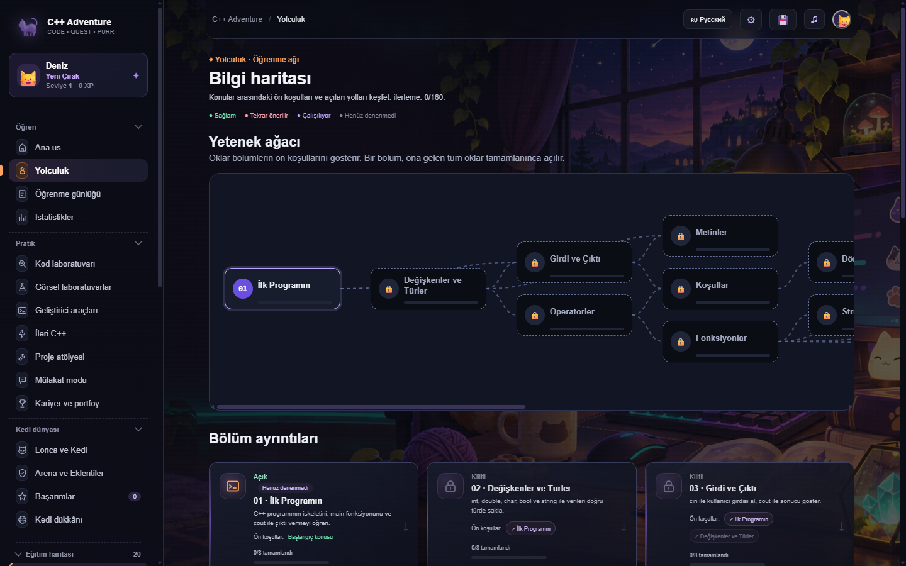
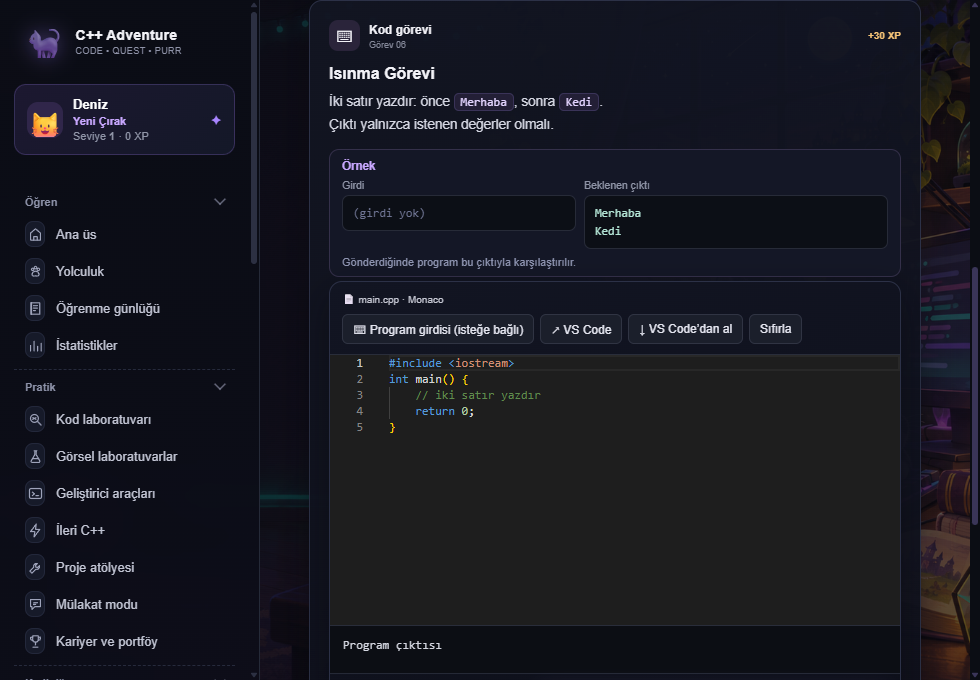
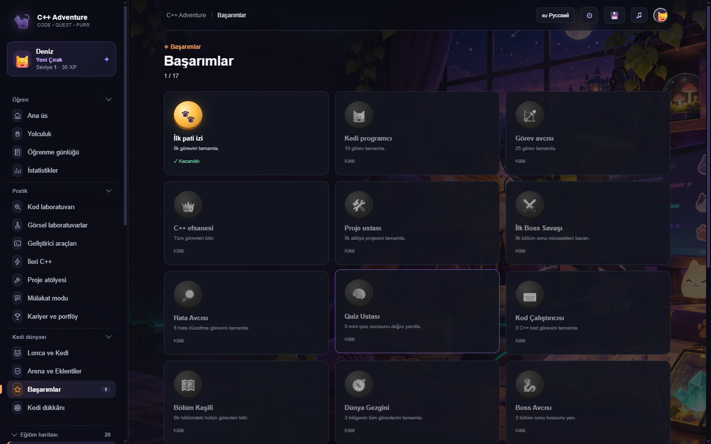
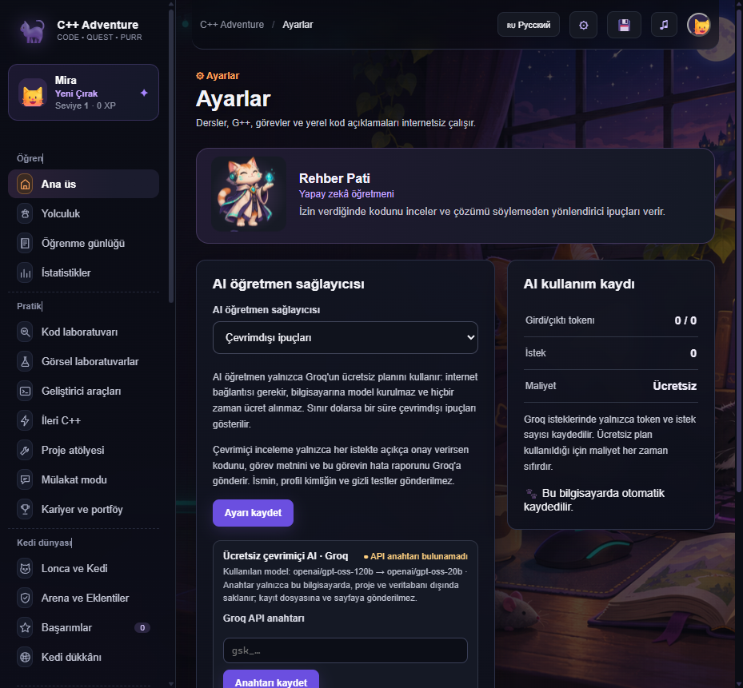

# C++ Adventure — Modernizasyon Sonuç Raporu

Tarih: 2026-11-21 · Dal: `modernization` (20 commit, `main` dokunulmadı, uzak depoya gönderilmedi) · Sürüm: **0.5.0**

Ayrıntılı teknik kayıt: [`DEVELOPMENT_LOG.md`](../DEVELOPMENT_LOG.md). Bu rapordaki test sonuçlarının hepsi gerçek çalıştırmalardan alındı.

## Özet

| | Önce | Sonra |
|---|---|---|
| Otomatik test | 167 | **293** (3 ardışık tam çalıştırma: 293/293 OK ×3) |
| Bölüm / görev | 20 / 160 | **24 / 192** (modern C++ yolu eklendi) |
| Veritabanı şeması | sürümsüz | 5 sürümlü migration, yükseltme öncesi otomatik yedek |
| Öğrenci kodu | kullanıcı haklarıyla çalışıyordu | AppContainer + Job Object sandbox (ağ ve dosya erişimi yok) |
| Cevaplar | tarayıcıda okunabiliyordu (160 görevin hepsi) | yalnızca sunucuda |
| AI öğretmen | Ollama (yerel), OpenAI, Claude (ücretli), Groq | **yalnızca Groq ücretsiz plan** (internet, ücret yok) |
| Değişen dosya | | 126 dosya, +22 331 / −5 374 satır (Faz 12 belgeleri hariç) |

## Aşamalar

**Faz 0 — Koruma.** 305 dosya ve 5 veritabanının SHA-256 doğrulamalı tam yedeği alındı: `C:\Users\user\CppAdventure-backups\phase0-2026-11-21\`. Git sahiplik sorunu, genel ayar değiştirmeden `-c safe.directory` ile aşıldı. Modernizasyon öncesi durum `02501de` commit'inde.

**Faz 1 — Kritik hatalar (11 adet, hepsi önce başarısız bir testle yakalandı).** Bazı POST uç noktaları 500 veriyordu. Bozuk istekler bağlantıyı düşürüyor ya da iş parçacığını kilitliyordu. Gerçekçi bir kayıt dosyası geri yüklenemiyordu. PIN korumalı profil PIN sorulmadan üzerine yazılabiliyordu. Eşzamanlı isteklerle ödüller iki kez alınabiliyordu. XP test paneli dağıtılan sürümde açık geliyordu. Bunların hepsi düzeltildi.

**Faz 2 — Güvenlik.**
- Öğrenci programları AppContainer içinde çalışıyor: ağ yok, kullanıcı dosyalarına erişim yok, alt süreç yok, bellek ve süre sınırı var. Programdaki derleme zamanı dosya okuma hileleri engellendi.
- Yerel API artık her açılışta yenilenen bir oturum çerezi istiyor.
- PIN kilidi tüm uç noktalarda geçerli. Sıkı CSP ve güvenlik başlıkları eklendi.
- API anahtarları Windows DPAPI ile şifreli saklanıyor. Bir XSS açığı kapatıldı.

**Faz 3 — Veritabanı.** Sürümlü migration'lar eklendi; her adım tek bir işlemde (transaction) çalışıyor. Profil içeren bir veritabanı yükseltilmeden önce doğrulanmış bir yedeği alınıyor. Daha yeni bir sürümün yazdığı veritabanı değiştirilmeden reddediliyor. Kayıt dosyası biçimi v2'ye geçti.

**Faz 4–5 — Mimari.** Sunucudaki uzun if zincirleri yönlendirme tablolarına çevrildi. Görevlere O(1) erişim sağlayan `content_index` eklendi. Arayüzde, modüllerin genel fonksiyonların üzerine yazması bırakıldı; bunun yerine `core.js` üzerinden kanca (hook) noktaları kullanılıyor. Açılışta kancaların kaçırılmasına yol açan bir yarış durumu giderildi.

**Faz 6 — Arayüz.**
- Tasarım belirteçleri (design tokens) ve yeni ana panel eklendi.
- Bölüm ön koşullarından otomatik çizilen yetenek ağacı geldi.
- Klavyeyle erişilebilen harita kartları, küçük ekranda tek sütunlu ders düzeni ve Monaco yüklenemezse devreye giren yedek editör eklendi.

**Faz 7 — Oyun ekonomisi.**
- Cevaplar tarayıcıya gitmiyor.
- Kazanılan XP (seviye) ile harcanabilir XP ayrıldı.
- Arena süresi ve çalışma süresi artık sunucunun ölçtüğü değere dayanıyor.
- İpuçları sunucuda kaydediliyor ve kullanılınca XP kesintisi uygulanıyor.
- Mülakat şıkları karıştırılıyor; önceden doğru cevap hep ilk şıktı.

**Faz 8 — Müfredat.** 4 yeni bölüm eklendi; hepsi Türkçe ve Rusça.

| Bölüm | Konu |
|---|---|
| 21 | Taşıma semantiği ve Beşler Kuralı |
| 22 | optional, variant, string_view |
| 23 | Concepts ve Ranges |
| 24 | Gerçek `std::thread`, `mutex`, `atomic` |

16 kod görevinin her birinin örnek çözümü testlerde gerçekten derleniyor ve gizli testlerin hepsini geçiyor. Başlangıç kodları kendiliğinden geçmiyor.

**Faz 9 — AI öğretmen.**
- Yalnızca Groq'un ücretsiz planı kullanılıyor; yerel ve ücretli seçenekler kaldırıldı.
- İpucu üç seviyeli; yanıt dili her zaman arayüz dili.
- Öğrenci kodu "güvenilmeyen veri" olarak işaretleniyor.
- Her hata türü sınıflandırılıyor ve Türkçe/Rusça açıklanıyor. Anahtar, token harcamadan sınanıyor.

**Faz 10 — Erişilebilirlik ve dil.**
- Erişilebilirlik:
  - Atlama bağlantısı ve `aria-current` eklendi.
  - Diyaloglarda odak tuzağı var.
  - Bir hata giderildi: diyalog içindeyken Escape tuşu kullanıcıyı profil ekranına atıyordu.
- Dil:
  - Türkçe alandaki Rusça metin düzeltildi.
  - ё ve е artık aynı harf sayılıyor.
  - Türkçe kedi adlarından geçersiz C++ kodu üretilmesi düzeltildi.
  - Yalnızca Türkçe olan 44 sunucu hatasına hata kodu ve Rusça karşılık eklendi.

**Faz 11 — Windows paketi.**
- Uygulama tek kopya çalışıyor; ikinci açılış mevcut pencereyi öne getiriyor.
- WebView2 eksikse bunu Türkçe ve Rusça bildiriyor.
- MSYS2 derleyicisi PATH'te olmasa da bulunuyor.
- Inno Setup kurulum betiği yazıldı: yönetici izni istemiyor, kaldırıcısı var ve kaldırırken kullanıcı verisini korur.
- Bağımlılıklar sabit sürümlere bağlandı. UPX kapatıldı ve exe'ye sürüm bilgisi eklendi.

## Ekran görüntüleri

| Önce | Sonra |
|---|---|
|  |  |
|  |  |

- Ders ekranı 980 px genişlikte, tek sütun: 
- Başarımlar: 
- Ücretsiz AI öğretmen ayarları: 

## Doğrulananlar (bu Windows 11 bilgisayarında)

- Tam test paketi üç kez arka arkaya çalıştırıldı: **293 OK / 293 OK / 293 OK** (253–259 sn).
- Sandbox engelleri gerçek programlarla denendi: dosya okuma/yazma, ağ, `system()`, sonsuz döngü, çıktı taşması ve bellek bombası.
- Gerçek sandbox'ta şunlar derlenip çalıştırıldı: thread/mutex/atomic, optional/variant, concepts/ranges, jthread.
- PyInstaller ile exe derlendi; dosya sürümü 0.5.0. Geçici bir veri klasörüyle iki kez açıldı: ikinci kopya 0.5 saniyede kapandı, ilk pencere öne geldi.
- Tarayıcıda (geçici veritabanıyla) şunlar denendi: panel, yetenek ağacı, yedek editör, ipucu akışı, ayarlar, Rusça hata mesajları, Escape ve odak davranışı.

## Doğrulanamayanlar / yapılmadı

- **Kurulum dosyası:** Inno Setup bu bilgisayarda kurulu değil. Betik yazıldı ama derlenmedi; kurulum ve kaldırma gerçekte denenmedi.
- **Kod imzası:** sertifika olmadığı için dosyalar imzasız. Windows SmartScreen uyarı gösterebilir.
- **AI öğretmen:** Groq'a gerçek bir istek gönderilmedi, çünkü bu bilgisayarda anahtar yok. Testler sahte yanıtlarla çalışıyor.
- **Ekran okuyucu:** NVDA ya da JAWS ile deneme yapılmadı. Erişilebilirlik kontrolleri yapısal ve klavye düzeyinde.
- **Henüz yapılmayan işler:**
  - Görev ve boss ekranlarının yeniden tasarımı
  - Kilitli başarım yazılarının düşük kontrastı
  - Dükkân fiyatlarının yeniden dengelenmesi
  - C++23 konuları (`std::expected`, `std::print`)
  - Çok dosyalı proje görevleri
- **Diğer:**
  - `server.py` hâlâ ~2 300 satır; servis ve depo katmanlarına bölünmesi sonraki bir iş.
  - Projedeki `dist\` derlemesi yenilenmedi.
  - Eski `dist-stage29-…` klasörü silinmedi.

## Senin yapman gerekenler

1. **AI öğretmen için:** https://console.groq.com/keys adresinden ücretsiz anahtar al (kredi kartı gerekmez). Uygulamada ⚙ Ayarlar → Groq API anahtarı kutusuna yapıştır.
2. **Kurulum dosyası için:** Inno Setup 6'yı kur (ücretsiz: https://jrsoftware.org/isdl.php) ve `build-windows.bat` dosyasını çalıştır.
3. **Birleştirme:** `modernization` dalını incele. Uygunsa `main` ile birleştir.
4. **İlk açılış:** Kurulu uygulama ilk açıldığında gerçek veritabanını şema 5'e yükseltecek. Bundan önce otomatik olarak doğrulanmış bir yedek alınır: `%LOCALAPPDATA%\CppAdventure\backups\`.

## Geri alma

- Kod: `git checkout 02501de` (modernizasyon öncesi). `main` dalı hiç değiştirilmedi.
- Veri: Faz 0 yedeği `C:\Users\user\CppAdventure-backups\phase0-2026-11-21\`. Yükseltme öncesi otomatik yedekler `%LOCALAPPDATA%\CppAdventure\backups\` klasöründe.
